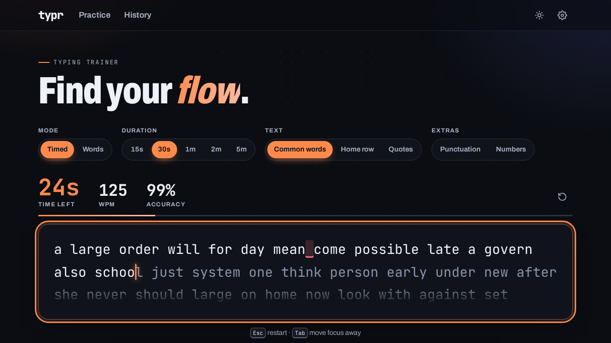
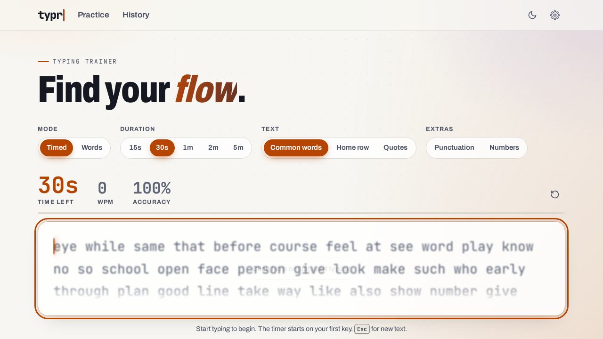
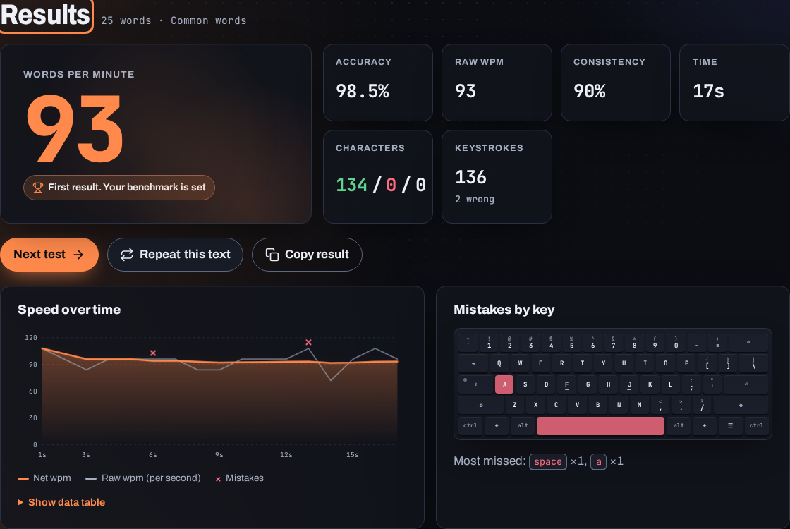
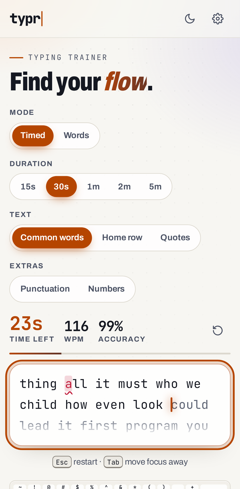

# typr

**Find your flow.** A keyboard-first, accessible typing trainer: timed and word tests, live WPM and
accuracy, an on-screen keyboard that shows the next key to press, speed graphs, a mistakes heat map
and private local history.

Live: [typr-zeta.vercel.app](https://typr-zeta.vercel.app)

| Dark                                                                                        | Light                                                                                       |
| ------------------------------------------------------------------------------------------- | ------------------------------------------------------------------------------------------- |
|  |  |





## Features

- **Tests:** timed (15s, 30s, 1m, 2m, 5m) or word count (10, 25, 50, 100).
- **Text:** common English words, **home row** drills (only `a s d f j k l ;`, the original typr
  brief) or quotes. Optional punctuation and numbers.
- **Honest scoring:** standard 5-characters-per-word WPM, raw WPM, accuracy that remembers
  corrected mistakes, and consistency (variation of per-second speed).
- **Live caret** that glides between characters, a 3-line scrolling prompt and a progress bar.
- **On-screen keyboard** (ANSI US) that lights up held keys, swaps legends while Shift is held,
  shows the Caps Lock LED and F/J homing bumps, highlights the **next key** (plus the correct
  opposite-hand Shift) and can colour keys by finger.
- **Results:** count-up WPM, personal-best detection with confetti, speed-over-time chart with
  mistakes marked, a per-second data table, a mistakes heat map, "Repeat this text" and "Copy
  result".
- **History:** saved privately in `localStorage` (never leaves the device); best, averages, trend
  and a sparkline.
- **Settings:** theme (system / dark / light), 4 accent colours, text size (S to XL), caret style,
  motion (system / reduced / full), keyboard options and screen reader announcements.

## Accessibility (WCAG 2.2 AA)

- Semantic landmarks (`header`, `nav`, `main`, `footer`), one `h1`, logical heading order and a
  **skip link** straight to the typing box.
- The typing box is a real, labelled `<input>`; its description tells screen readers the next
  character and upcoming words. Visual-only parts (character spans, keyboard) are `aria-hidden`
  and everything they show is also available as text.
- A single polite live region announces **only meaningful moments**: 30/10/5 seconds left (can be
  turned off) and a one-line result summary. Never every keystroke.
- Focus moves to the Results heading when a test ends, and back into the input on "Next test".
  Changing options never steals focus.
- **No keyboard traps:** <kbd>Tab</kbd> always leaves the typing box; <kbd>Esc</kbd> restarts.
  Paste and caret movement inside the prompt are blocked so results stay honest.
- All controls are native (radio groups, checkbox switches, `<dialog>`) with visible
  `:focus-visible` rings and 44px touch targets.
- **Colour contrast is tested in CI:** `src/styles/contrast.test.ts` parses the design tokens
  and asserts at least 4.5:1 for all text and 3:1 for control borders in both themes and every
  accent. Errors are shown with colour **and** a wavy underline / background, not colour alone.
- Respects `prefers-reduced-motion` (overridable in settings), `prefers-color-scheme` and
  `forced-colors` (Windows High Contrast).
- axe-core runs in unit tests (jsdom) and in real Chromium via Playwright on desktop dark,
  desktop light and mobile.

## Stack

|               |                                                                                                                                        |
| ------------- | -------------------------------------------------------------------------------------------------------------------------------------- |
| Build         | [Vite 8](https://vite.dev) (Rolldown)                                                                                                  |
| UI            | React 19 with the **React Compiler** (automatic memoisation)                                                                           |
| Language      | TypeScript 7 (native `tsgo`) in strict mode, plus `noUncheckedIndexedAccess` and `exactOptionalPropertyTypes`                          |
| Styling       | Modern plain CSS: cascade layers, `color-mix()`, `@property`, `@starting-style`, container queries, `:has()`, `linear()` spring easing |
| Fonts         | Archivo (variable width) + JetBrains Mono, self-hosted via Fontsource                                                                  |
| Lint / format | [oxlint](https://oxc.rs) (react, jsx-a11y, typescript, import, unicorn, vitest plugins) + Prettier                                     |
| Tests         | Vitest 5 + Testing Library + axe-core; Playwright + @axe-core/playwright                                                               |
| CI            | GitHub Actions: lint, format, typecheck, unit tests with coverage, build, E2E                                                          |

This matches the approach of [3bpm-redesign](https://github.com/leoelicos/3bpm-redesign) (Vite,
React 19, TypeScript 7, oxlint, plain CSS with design tokens). typescript-eslint doesn't support
TypeScript 7 yet, so oxlint is the linter.

## Scripts

```bash
npm install
npm run dev            # local dev server
npm run build          # typecheck + production build to dist/
npm run preview        # serve the production build

npm run lint           # oxlint (warnings fail)
npm run format         # prettier --write
npm run typecheck      # tsc -b
npm test               # unit + component + axe tests (Vitest)
npm run test:coverage
npm run test:e2e       # Playwright smoke + axe (run `npx playwright install chromium` once)
npm run screenshots    # regenerate docs/screenshots
npm run check          # everything CI runs, except E2E
```

Requires Node 22.12+ (see `.nvmrc`).

## Project structure

```
src/
  App.tsx                 page composition, focus management, announcements
  components/             TypingTest, Keyboard, Results, WpmChart, History, SettingsDialog, ...
  lib/
    session.ts            pure reducer: keystrokes, timer, per-second samples
    scoring.ts            WPM / accuracy / consistency maths
    text.ts, words.ts     seeded text generation (repeatable tests)
    keyboard.ts           keyboard layout as data, char -> key + Shift mapping
    settings.ts, history.ts, store.ts   validated localStorage stores (useSyncExternalStore)
    hooks.ts              typing session, pressed keys, appearance, count-up
  styles/                 tokens.css (themes, accents) + base.css
e2e/                      Playwright specs
```

## Deploy

Static site on Vercel. `vercel.json` pins the Vite framework preset, `npm run build` and the
`dist` output directory, so the existing project builds without dashboard changes.

## License

MIT © Leo Wong
